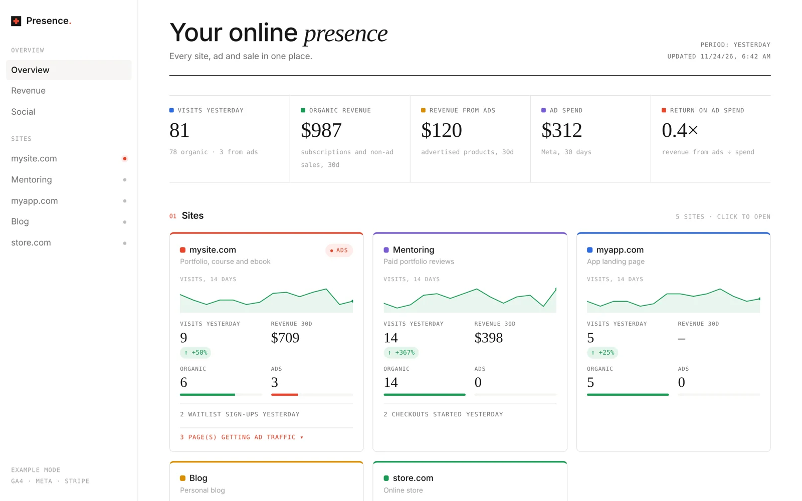
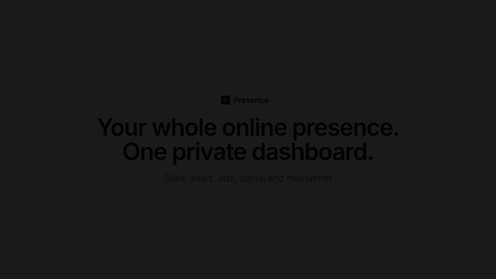

# Presence



A free, open-source private dashboard for your whole online presence. Your sites, sales, ads, social accounts and newsletter on one screen, updated every time you open it.

No database, no dependencies, no build step. It runs on Vercel's free plan.

Made by [alvarosouza.com](https://www.alvarosouza.com).



## Features

- **Overview:** every site with yesterday's visits split into organic and ads, plus organic revenue, revenue from ads, ad spend and return on ad spend
- **Site pages:** top pages, traffic sources, countries, organic vs ads per day, and the pages getting ad traffic grouped by campaign
- **Landing pages:** visits, conversions, conversion rate, sales and whether an ad is running, plus who joined the list in Kit
- **Revenue:** today so far, by day, week or month, compared with the previous 30 days, by product, with refunds, failed charges and the balance pending in Stripe, plus app subscriptions from RevenueCat
- **Campaigns:** Meta Ads spend, results, cost per result and creatives, with campaigns that stopped delivering flagged
- **Return per campaign:** sales, spend, revenue and ROI per campaign, plus what you actually paid Meta and the balance left
- **Sale sources:** every sale tagged as ad, organic, direct or recurring from your UTMs, with a product filter. See [docs/tracking.md](docs/tracking.md)
- **Social:** YouTube subscribers and latest videos, Instagram followers, reach and new followers per post, newsletter subscribers and open rates
- **Private:** Google sign-in for the e-mails you allow, signed session cookie, read-only keys, hidden from search engines
- **Pluggable:** every source is optional and independent, and adding a new one is a single file

## Sources

| Source | What it brings | Variable |
|---|---|---|
| Google Analytics 4 | visits, pages, sources, countries, conversions | `GA4_SERVICE_ACCOUNT_JSON` |
| Stripe | sales, products, refunds, pending balance | `STRIPE_PORTAL_KEY` |
| Meta Ads | campaigns, spend, results, creatives | `META_ACCESS_TOKEN` |
| Instagram | followers, reach, posts | `INSTAGRAM_ACCESS_TOKEN` |
| YouTube | subscribers, views, videos | `YOUTUBE_REFRESH_TOKEN` |
| Kit | newsletter and landing page lists | `KIT_API_KEY` |
| RevenueCat | app subscriptions: MRR, revenue, subscriptions, trials | `REVENUECAT_API_KEY` |

With no source connected, the portal opens with example data so you can see how it looks.

## Use it

1. Click **Use this template** at the top of this repository to create your own copy.
2. Import it in [Vercel](https://vercel.com/new). There is nothing to build.
3. Set up Google sign-in and add the four login variables from [`.env.example`](.env.example). Step by step: [docs/setup.md](docs/setup.md#1-google-sign-in).
4. Open `https://your-domain/portal`.

**Locally:** run `npx vercel dev` in the folder and open `http://localhost:3000/portal/`.

## Make it yours

1. Edit `api/portal/_lib/sites.js` with your sites, products, landing pages and social accounts. It is the only config file.
2. Connect the sources you want, one at a time, following [docs/setup.md](docs/setup.md). Each one turns on as soon as its variable exists.
3. Set `PORTAL_CURRENCY` and `PORTAL_TZ` for your currency and time zone.
4. Edit `portal/portal.css` to restyle the dashboard, and `privacy.html` with your name and contact.

After changing an environment variable in Vercel, deploy again: Vercel only reads new variables on the next deploy.

## Project structure

```
portal/                  Dashboard (plain HTML, CSS and JavaScript)
  portal.js              Screens: overview, revenue, social, site
  portal.css             Styles
  data-exemplo.js        Example data shown when nothing is connected
api/portal/              Vercel serverless functions
  data.js                Builds the dashboard data (sign-in required)
  auth/                  Google sign-in and YouTube authorization
  _lib/sites.js          Your config
  _lib/sources/          One file per source
privacy.html             Privacy policy template
docs/                    Setup guide and architecture
```

Adding a source, like Search Console or the App Store: see [docs/architecture.md](docs/architecture.md).

## Privacy

Everything runs in your own Vercel project. Your data goes straight from each service to your portal and is never stored or sent anywhere else. All keys are read-only and live in your environment variables, never in the code.

## License

MIT. See [LICENSE](LICENSE). You can use, copy, modify and sell it freely.
